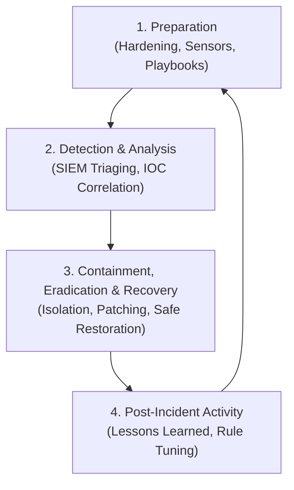

**Sound the Alarm: Detection and Response** is the 6th course in the Google Cybersecurity Professional Certificate. This course covers the core responsibilities of a Security Operations Center (SOC) Analyst: configuring and querying **Security Information and Event Management (SIEM)** tools, analyzing network intrusion detection systems (**Suricata / Snort**), and executing structured incident response protocols following the **NIST SP 800-61 Rev. 2** framework.

---

## Course Information

| Attribute | Specification |
|:---|:---|
| **Platform** | Coursera |
| **Certificate** | Google Cybersecurity Professional Certificate |
| **Course** | 6 of 8 — Sound the Alarm: Detection and Response |
| **Status** | ✅ Completed |
| **Key Frameworks** | NIST SP 800-61 Rev. 2, MITRE ATT&CK, Pyramid of Pain |
| **Core Technologies** | Chronicle SIEM, Splunk Enterprise, Suricata, Wireshark, tcpdump |

---

## 1. The Incident Response Lifecycle (NIST SP 800-61)

Incident response is not ad-hoc; it follows a rigorous 4-phase cyclical process:



### Phase Breakdown
1. **Preparation**: Establishing baseline telemetry, deploying endpoint detection agents (Sysmon/EDR), defining communication trees, and authoring automated playbooks.
2. **Detection & Analysis**: Monitoring alert queues, distinguishing true positives from false alarms, calculating severity metrics, and scoping the attack blast radius.
3. **Containment, Eradication & Recovery**:
   - *Short-term Containment*: Network isolation of compromised subnets, firewall shun rules.
   - *Eradication*: Terminating malicious processes, deleting persistence keys, revoking compromised Kerberos/OAuth tokens.
   - *Recovery*: Restoring from verified clean offline backups, rotating passwords, continuous 72-hour watch.
4. **Post-Incident Activity**: Documenting timeline of events, executive summaries, Root Cause Analysis (RCA), and tuning detection thresholds to prevent recurrence.

---

## 2. SIEM Architecture & Chronicle Ingestion

A SIEM serves as the centralized brain of a SOC. It aggregates, normalizes, correlates, and alerts on logs from disparate endpoints:

```
[Endpoints: Sysmon / EventLogs] ──┐
[Network: Suricata / Zeek / NGINX] ─┼──> Forwarders (Logstash / Fluentd) ──> SIEM Engine (Chronicle / Splunk)
[Cloud: AWS CloudTrail / Azure] ──┘
```

### Chronicle UDM (Unified Data Model)
Chronicle normalizes raw logs into standardized UDM structures. An example of hunting for suspicious outbound DNS beaconing using Unified Data Model search:

```yaml
metadata.event_type = "NETWORK_DNS"
network.dns.questions.name = /.*\.xyz$/
target.ip = "198.51.100.24"
```

---

## 3. Intrusion Detection Systems (IDS): Suricata in Practice

Suricata is a high-performance open-source Network Threat Detection engine capable of real-time intrusion detection (IDS), intrusion prevention (IPS), and network security monitoring (NSM).

### Anatomy of a Suricata Detection Rule

```
alert tcp $EXTERNAL_NET any -> $HOME_NET 22 (msg:"ET SCAN Potential SSH Brute Force"; flags:S; threshold:type both, track by_src, count 5, seconds 60; classtype:attempted-recon; sid:2001219; rev:3;)
```

### Rule Dissection:
- **Action (`alert`)**: Creates an alert log without dropping traffic (in IPS mode, `drop` would discard packets).
- **Protocol & Direction (`tcp $EXTERNAL_NET any -> $HOME_NET 22`)**: Inspects TCP ingress into internal SSH servers.
- **`msg`**: Human-readable label displayed in SOC alert queues.
- **`flags:S`**: Matches TCP SYN packets (connection initiation).
- **`threshold`**: Limits alerts to when a single source IP generates $\ge 5$ SYN packets within 60 seconds (prevents alert fatigue while catching scanners).
- **`sid / rev`**: Unique Signature ID and revision number.

---

## 4. The Pyramid of Pain in Alert Triage

When triaging alerts, SOC analysts classify Indicators of Compromise (IoCs) according to David Bianco's **Pyramid of Pain**:

| Indicator Layer | Difficulty for Adversary to Change | SOC Action / Triage Level |
|:---|:---|:---|
| **Hash Values** (MD5, SHA256) | Trivial (1-byte change changes hash) | Automated blacklisting |
| **IP Addresses** | Easy (VPNs, Tor, cloud proxies) | Temporary firewall shuns |
| **Domain Names** | Simple (Dynamic DNS, domain generation algos) | DNS Sinkholing |
| **Network / Host Artifacts** | Annoying (User-Agent strings, URI paths) | Proxy & WAF regex rules |
| **Tools** | Challenging (Requires finding/rewriting tools) | Hash + behavior detection |
| **TTPs (Tactics, Techniques & Procedures)** | **Tough / Maximum Pain** (Adversary must relearn skills) | **MITRE ATT&CK Behavioral Detections** |

---

## SOC Analyst Reflection

The biggest takeaway from this course is that **preventative controls always fail eventually**. Modern security operations assume breach: success is measured not by whether an attacker touches your network, but by **Mean Time to Detect (MTTD)** and **Mean Time to Remediate (MTTR)**. Mastering SIEM correlation and IDS signature logic is the bedrock of defensive cybersecurity.
