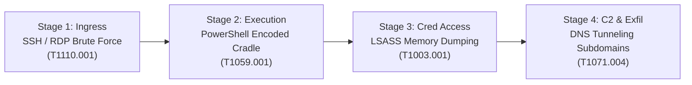

In a modern enterprise Security Operations Center (SOC), a Tier-1/Tier-2 analyst does not merely respond to flashing red dashboard lights—they hunt through raw machine telemetry to reconstruct active attack chains.

This case study breaks down an end-to-end multi-stage intrusion investigation in **Splunk Enterprise SIEM**, detailing the exact **Search Processing Language (SPL)** queries used to detect brute-force ingress, encoded PowerShell payloads, LSASS memory credential dumping, and DNS C2 beaconing mapped to the **MITRE ATT&CK** framework.

---

## Technical Incident Profile

| Dimension | Telemetry Profile |
|:---|:---|
| **SIEM Platform** | Splunk Enterprise 9.x |
| **Ingested Sourcetypes** | `wineventlog:security`, `xmlwineventlog:microsoft-windows-sysmon/operational`, `suricata` |
| **Attack Vector** | External Ingress ➔ Credential Access ➔ Defense Evasion ➔ Exfiltration |
| **Analyzed MITRE Tactics** | Initial Access (TA0001), Execution (TA0002), Credential Access (TA0006), Command & Control (TA0011) |

---

## The Investigated Attack Kill Chain



---

## Scenario 1: Hunting Authentication Brute Force (T1110.001)

### Attack Context
An external adversary launches a password spraying or brute force attack against internal Active Directory accounts.

### Windows Security Event ID
- **Event ID 4625**: An account failed to log on.

### Production SPL Detection Query

```spl
index=wineventlog sourcetype="wineventlog:security" EventCode=4625
| eval src_ip = coalesce(IpAddress, WorkstationName, "UNKNOWN")
| bin _time span=5m
| stats count as failure_count, 
        dc(TargetUserName) as targeted_users, 
        values(TargetUserName) as user_samples, 
        values(SubStatus) as error_codes 
        by src_ip, _time
| where failure_count > 15
| eval alert_severity = if(failure_count > 50, "CRITICAL", "HIGH")
| sort - failure_count
```

### Analyst Evaluation & Interpretation:
- `dc(TargetUserName)`: A high distinct user count with low failures per user indicates a **Password Spraying** campaign (trying one common password across 100 accounts to evade lockouts).
- High `failure_count` against a single account indicates a **Targeted Brute Force** attack.
- `SubStatus = 0xC000006A`: Wrong password.
- `SubStatus = 0xC0000234`: Account locked out.

---

## Scenario 2: Detecting Obfuscated PowerShell Execution (T1059.001)

### Attack Context
Following ingress, the attacker downloads a stage-two payload by launching an obfuscated, base64-encoded PowerShell process designed to bypass traditional command-line argument auditing.

### Telemetry Source
- **Event ID 4104 (Script Block Logging)**: Captures complete executable content even if obfuscated on the CLI.

### Production SPL Hunting Query

```spl
index=wineventlog sourcetype="xmlwineventlog:microsoft-windows-powershell/operational" EventCode=4104
| eval ScriptBlock = lower(ScriptBlockText)
| regex ScriptBlockText="(?i)(frombase64string|downloadstring|invoke-expression|iex|bypass|windowstyle hidden|-w 1)"
| stats count as execution_count, 
        values(ComputerName) as affected_hosts, 
        values(UserId) as executing_users, 
        latest(ScriptBlockText) as payload_sample 
        by ScriptBlockText, _time
| eval entropy = len(ScriptBlockText)
| where entropy > 120
| table _time, affected_hosts, executing_users, payload_sample
```

### Analyst Evaluation:
Script block logging strips away the initial `powershell.exe -enc <base64>` wrapper and logs the **unrolled, executed code in memory**. Catching `.DownloadString()` or `FromBase64String` combined with execution flags (`-w hidden`) triggers an immediate high-priority triage incident.

---

## Scenario 3: Identifying LSASS Memory Dumping via Sysmon (T1003.001)

### Attack Context
The attacker executes Mimikatz or `procdump.exe` to carve cleartext passwords and NTLM password hashes directly out of the Local Security Authority Subsystem Service (`lsass.exe`).

### Sysmon Event ID
- **Sysmon Event ID 10**: ProcessAccess (monitors when a process opens a handle to another process).

### Production SPL Detection Query

```spl
index=sysmon sourcetype="xmlwineventlog:microsoft-windows-sysmon/operational" EventCode=10
| eval Target = lower(TargetImage)
| where like(Target, "%lsass.exe")
| search NOT SourceImage IN ("*\\svchost.exe", "*\\csrss.exe", "*\\MsMpEng.exe")
| eval GrantedAccessMask = GrantedAccess
| where GrantedAccess IN ("0x1010", "0x1410", "0x143a", "0x1fffff")
| table _time, Computer, SourceImage, TargetImage, GrantedAccess, CallTrace
```

### Analyst Evaluation:
- Non-standard binaries opening handles to `lsass.exe` with access mask **`0x1010` (`PROCESS_VM_READ | PROCESS_QUERY_INFORMATION`)** are attempting to read process memory space.
- Legitimate Windows Defender (`MsMpEng.exe`) is explicitly excluded to eliminate false positives.

---

## Scenario 4: DNS C2 Exfiltration & Beaconing (T1071.004)

### Attack Context
To exfiltrate collected credentials past firewall egress filters, the attacker uses DNS tunneling, encoding stolen NTLM hashes into dynamic subdomains (e.g., `4a7f.c3RhZ2Ux.evil-c2.net`).

### Telemetry Source
- **Suricata DNS Logs** (`sourcetype=suricata` event_type=dns).

### Production SPL Threat Hunting Query

```spl
index=suricata sourcetype="suricata" event_type=dns
| eval domain_len = len(query)
| where domain_len > 45
| rex field=query "(?<subdomain>^[^\.]+)\.(?<parent_domain>[^\.]+\.[^\.]+$)"
| stats count as query_count, 
        dc(query) as unique_subdomains, 
        values(src_ip) as internal_clients 
        by parent_domain
| where unique_subdomains > 50
| eval ratio = unique_subdomains / query_count
| where ratio > 0.8
| table parent_domain, unique_subdomains, query_count, internal_clients
| sort - unique_subdomains
```

### Analyst Evaluation:
Legitimate DNS lookups feature high query repetition for standard root domains (e.g. `google.com`). DNS tunneling engines generate thousands of **high-entropy, single-use subdomains** that never repeat, resulting in a distinct query ratio close to `1.0`.

---

## SOC Tier-1 Playbook: Incident Escalation Workflow

```
[Incoming High Alert: LSASS Handle 0x1010]
   │
   ├─ 1. Endpoint Triage:
   │     - Isolate host from corporate network via EDR agent.
   │     - Capture full triage memory dump (WinPmem).
   │
   ├─ 2. Scope Lateral Movement:
   │     - Query SIEM for Event ID 4624 (Logon Type 3: Network / Type 10: RDP) from source host IP.
   │
   ├─ 3. Credential Remediation:
   │     - Force enterprise password and Kerberos Golden Ticket (KRBTGT) reset.
   │
   └─ 4. Threat Intelligence Sharing:
         - Submit observed hashes & external C2 IP to MISP / threat intelligence feeds.
```

Mastering Splunk SPL and Sysmon event telemetry allows an analyst to elevate from passively acknowledging alerts to conducting deep behavioral threat hunts that catch modern adversaries before ransomware deployment or data exfiltration occurs.
