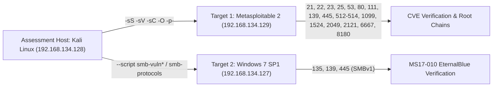

# Port-by-Port Vulnerability Assessment & Enterprise Remediation Report

During perimeter and internal vulnerability assessments, running a quick top-1000 port scan creates dangerous blind spots. Legacy backdoors, administrative RMI interfaces, and misconfigured UNIX RPC exports routinely hide above port 1024 or behind permissive host configurations.

This technical assessment documents a complete **full-port (`0–65535`) vulnerability audit, CVE mapping, exploitation verification, and enterprise ACL port-filtering remediation plan** conducted in an isolated VMware lab against **Metasploitable 2 (Ubuntu 8.04)** and **Windows 7 SP1**.

---

## 1. Engagement Scope & Lab Architecture

| Role | Host / OS | IP Address | Primary Attack Surface |
|---|---|---|---|
| **Assessment Host** | Kali Linux (2024.x / Nmap 7.94 / Metasploit) | `192.168.134.128` | Isolated VMware NAT / Host-Only (`192.168.134.0/24`) |
| **Target 1 (Linux)** | Metasploitable 2 (Ubuntu 8.04, Kernel `2.6.24-16`) | `192.168.134.129` | 20+ open legacy TCP/UDP services, backdoors, NFS/Samba |
| **Target 2 (Windows)** | Windows 7 SP1 (NT `6.1` Build `7601`) | `192.168.134.127` | MSRPC (`135`), NetBIOS (`139`), SMBv1 (`445`, MS17-010) |



---

## 2. Phase 1 — Discovery & Nmap Vulnerability Scanning Methodology

To ensure zero missed services and preserve machine-readable evidence for reporting, scanning was performed in three progressive stages using `-oA` (`*.nmap`, `*.xml`, `*.gnmap`):

```bash
# 1. Host Reachability Verification
ping -c 4 192.168.134.129
ping -c 4 192.168.134.127

# 2. Full 65,535-Port SYN Stealth, Service Version, Default Scripts & OS Fingerprint
sudo nmap -sS -sV -sC -O -p- --min-rate 1500 -oA ms2_full_audit 192.168.134.129
sudo nmap -sS -sV -sC -O -oA win7_baseline 192.168.134.127

# 3. Targeted NSE CVE & Vulnerability Sweeps
nmap -Pn --script vuln -p- 192.168.134.129 -oN ms2_nse_vuln.nmap
nmap -Pn --script smb-protocols,smb-vuln* -p 139,445 192.168.134.127 -oN win7_smb_vuln.nmap
```

### Representative Nmap Output Summary (`192.168.134.129`)

```text
PORT     STATE SERVICE     VERSION
21/tcp   open  ftp         vsftpd 2.3.4
22/tcp   open  ssh         OpenSSH 4.7p1 Debian 8ubuntu1 (protocol 2.0)
23/tcp   open  telnet      Linux telnetd
25/tcp   open  smtp        Postfix smtpd
53/tcp   open  domain      ISC BIND 9.4.2
80/tcp   open  http        Apache httpd 2.2.8 ((Ubuntu) DAV/2)
111/tcp  open  rpcbind     2 (RPC #100000)
139/tcp  open  netbios-ssn Samba smbd 3.X - 4.X (workgroup: WORKGROUP)
445/tcp  open  netbios-ssn Samba smbd 3.X - 4.X (workgroup: WORKGROUP)
512/tcp  open  exec        netkit-rsh rexecd
513/tcp  open  login       OpenBSD or Solaris rlogind
514/tcp  open  tcpwrapped
1099/tcp open  java-rmi    GNU Classpath grmiregistry
1524/tcp open  bindshell   Metasploitable root shell
2049/tcp open  nfs         2-4 (RPC #100003)
2121/tcp open  ftp         ProFTPD 1.3.1
3306/tcp open  mysql       MySQL 5.0.51a-3ubuntu5
5432/tcp open  postgresql  PostgreSQL DB 8.3.0 - 8.3.7
5900/tcp open  vnc         VNC (protocol 3.3)
6000/tcp open  X11         (access denied)
6667/tcp open  irc         UnrealIRCd
8009/tcp open  ajp13       Apache Jserv (Protocol v1.3)
8180/tcp open  http        Apache Tomcat/Coyote JSP engine 1.1
```

---

## 3. Master Port-by-Port Risk & CVE Matrix

| Port | Service & Version | Primary Vulnerability / CWE / CVE | Severity | Verification Method | Privilege Impact |
|---|---|---|---|---|---|
| **21/tcp** | `vsftpd 2.3.4` | Supply-chain backdoor via `:)` user (`CVE-2011-2523`) | **Critical (10.0)** | `exploit/unix/ftp/vsftpd_234_backdoor` / `nc` port `6200` | Unauthenticated `root` |
| **1524/tcp** | `ingreslock` (`inetd`) | Intentional persistent root bindshell (`/etc/inetd.conf`) | **Critical (10.0)** | `nc 192.168.134.129 1524` | Unauthenticated `root` |
| **139, 445/tcp** | `Samba smbd 3.0.20-Debian` | `username map script` cmd injection (`CVE-2007-2447`) + Null session | **Critical (9.8)** | `exploit/multi/samba/usermap_script`, `smb_version` | Unauthenticated `root` |
| **445/tcp** *(Win7)* | Microsoft `SMBv1` (`srv.sys`) | EternalBlue Kernel Pool Overflow (`CVE-2017-0143` / `MS17-010`) | **Critical (9.8)** | `smb-vuln-ms17-010`, `ms17_010_eternalblue` | `NT AUTHORITY\SYSTEM` |
| **1099/tcp** | `GNU Classpath grmiregistry` | Insecure RMI remote class loading (`CVE-2011-3556`) | **Critical (9.8)** | `rmi-vuln-classloader`, `java_rmi_server` | `root` (Meterpreter) |
| **6667/tcp** | `UnrealIRCd 3.2.8.1` | Trojanized backdoor download (`AB;` command exec, `CVE-2010-2075`) | **Critical (9.8)** | `nmap --script irc-unrealircd-backdoor` | Daemon / `root` |
| **111, 2049/tcp** | `rpcbind 2` + `NFS` (`mountd 32771`) | World-exported root FS `/ *`, `RPCbomb` (`CVE-2017-8779`) | **Critical (9.1)** | `rpcinfo -p`, `showmount -e`, `mount -o nfsvers=3` | Full FS Read / Pivot |
| **80, 8180/tcp** | `Apache 2.2.8 DAV/2`, `PHP 5.2.4`, `Tomcat` | WebDAV `PUT`, PHP-CGI (`CVE-2012-1823`), Default Tomcat creds | **Critical (9.8)** | `cadaver`, `php_cgi_arg_injection`, WAR upload | `www-data` / `tomcat` |
| **512–514/tcp** | `rexecd` / `rlogind` / `rshd` | Cleartext auth, `.rhosts` host trust (`CVE-1999-0502`, `CVE-1999-0651`) | **High (8.8)** | `rexec_login` (`CMD id`), `rlogin` | User -> `sudo root` |
| **5432/tcp** | `PostgreSQL 8.3.x` | Weak default `postgres:postgres` + `COPY TO PROGRAM` / UDF RCE | **High (8.8)** | `postgres_login`, SQL `pg_read_file` | DB Admin / OS Exec |
| **5900/tcp** | `VNC (RFB 3.3)` | Weak default password `password`, unencrypted screen stream | **High (8.1)** | `auxiliary/scanner/vnc/vnc_login` | Interactive X11 Desktop |
| **3306/tcp** | `MySQL 5.0.51a` | Blank root password (`root:""`) exposed to network | **High (7.5)** | `mysql -h 192.168.134.129 -u root` | Full DB Compromise |
| **53/tcp/udp** | `ISC BIND 9.4.2` | Open DNS recursion, AXFR leak, `CVE-2008-1447` (Kaminsky) | **High (7.5)** | `dig AXFR`, `dns-zone-transfer.nse`, `fierce` | Zone Intel Disclosure |
| **23/tcp** | `Linux telnetd` | Cleartext credential exposure (`CWE-319`), default creds | **High (7.5)** | `telnet_login`, Wireshark capture | `msfadmin` -> `sudo` |
| **22/tcp** | `OpenSSH 4.7p1 Debian` | Weak credentials + Debian Predictable PRNG (`CVE-2008-0166`) | **Medium/High (7.0)** | `ssh_login`, `ssh_publickey` | `msfadmin` / Key Match |
| **2121/tcp** | `ProFTPD 1.3.1` | Weak cleartext credentials (`user:user`, `msfadmin`); `mod_sql` off | **Medium (6.5)** | `USER %` probe, `ftp_login`, `hydra -s 2121` | Local User Read |
| **25/tcp** | `Postfix smtpd` | `VRFY`/`EXPN` User Enumeration, unauthenticated relay exposure | **Medium (5.3)** | `nc` `VRFY`, `smtp_enum`, `smtp-user-enum` | Valid OS Usernames |
| **6000/tcp** | `X11` (`access denied`) | Legacy clear X-Window display socket exposed on network | **Low (3.7)** | `nmap -p 6000 -sV` | Hardening / Exposure |
| **8009/tcp** | `Apache Jserv AJPv1.3` | Unauthenticated internal servlet connector exposure | **Medium (5.3)** | Nmap version probe | Internal App Pivot Risk |

---

## 4. Port-by-Port Technical Verification & Troubleshooting Notes

### 4.1 Critical Unauthenticated Root Chains (`21`, `1524`, `139/445`, `1099`)

1. **Port 21 — `vsftpd 2.3.4` (`CVE-2011-2523`)**:
   - Sending any `USER` ending with `:)` triggers a bind shell on TCP port `6200` with UID `0`.
   - Verified manually without Metasploit via raw Netcat (`nc 192.168.134.129 21` -> `USER pwn:)` -> `nc 192.168.134.129 6200`) and via `exploit/unix/ftp/vsftpd_234_backdoor`.

2. **Port 1524 — `ingreslock` Root Bindshell**:
   - Defined directly inside `/etc/inetd.conf` (`1524 stream tcp nowait root /bin/bash bash -i`). Connecting via `nc -nv 192.168.134.129 1524` or `telnet` returns an immediate `root@metasploitable:/#` prompt. In production incident response, an open port `1524` shell indicates active prior compromise.

3. **Ports 139 & 445 — `Samba 3.0.20-Debian` (`CVE-2007-2447`)**:
   - Standard Nmap `-sV` reports `Samba smbd 3.X - 4.X`. Exact version confirmation was obtained via `auxiliary/scanner/smb/smb_version` (`[+] Host is running Samba 3.0.20-Debian`), alongside null-session enumeration (`smbclient -L //192.168.134.129 -N`, `enum4linux -a`) revealing a writable `tmp` share.
   - `exploit/multi/samba/usermap_script` with `PAYLOAD cmd/unix/reverse` injects shell metacharacters into the pre-authentication username field and returns a `root` shell. *(Operational lesson: lightweight `cmd/unix/reverse` succeeds reliably on legacy Linux 2.6.24 where staged Meterpreter binaries can hang.)*

4. **Port 1099 — `Java RMI` (`GNU Classpath grmiregistry`, `CVE-2011-3556`)**:
   - `nmap -p 1099 --script rmi-dumpregistry,rmi-vuln-classloader` confirmed remote class loading over DGC is enabled.
   - `exploit/multi/misc/java_rmi_server` (configured with `SRVPORT 8888` to avoid local proxy collisions on `8080`) injects an HTTP codebase annotation, forcing the target JVM to fetch and execute a malicious JAR as `root`.
   - *CVE Verification Note*: `CVE-2011-3556` covers insecure default remote class loading pre-JDK 7u21, whereas `CVE-2017-3241` covers 2017 `bind`/`rebind` JRMP deserialization gadget chains.

---

### 4.2 Filesystem, Authentication & Legacy Service Exposures (`111/2049`, `22`, `23`, `25`, `53`, `512–514`, `2121`)

* **Ports 111 & 2049 (`rpcbind` & `NFS`)**:
  - `rpcinfo -p 192.168.134.129` mapped `nfs` (`2049`) and `mountd` (`32771`); `showmount -e` revealed `Export list -> / *` (entire root filesystem exported globally).
  - *Troubleshooting Pivot*: Mounting with FAT/NTFS options (`-o uid=1000,gid=1000`) failed with `mount.nfs: an incorrect mount option was specified`; switching to `-o nfsvers=3` succeeded cleanly. Reading `/etc/shadow` initially failed due to `root_squash` (mapping client UID `0` to `nobody`), while world-readable config files (`/var/www/dvwa/config/config.inc.php`) and SSH/sudo (`scp` + `john`) yielded full credential access.

* **Port 25 (`Postfix VRFY`) & Port 53 (`ISC BIND 9.4.2`)**:
  - Port `25` permitted unauthenticated `VRFY root` / `VRFY msfadmin` enumeration (`252 2.0.0`), feeding confirmed OS usernames directly into targeted credential audits.
  - Port `53` ran BIND `9.4.2` (`CVE-2008-1447` Kaminsky cache poisoning, `CVE-2008-0122`), permitted open recursion, and answered `AXFR` zone transfer queries cleanly (`dig @192.168.134.129 localhost AXFR`).

* **Ports 512 / 513 / 514 (Berkeley r-services) & Port 2121 (`ProFTPD 1.3.1`)**:
  - Metasploit's `auxiliary/scanner/rservices/rexec_login` hangs indefinitely if `CMD` is left unset (defaults to interactive `sh -i`); setting `set CMD id` confirmed valid `msfadmin:msfadmin` login cleanly, while `rsh-redone-client` (`rlogin -l msfadmin`) established an interactive shell on port `513`.
  - On port `2121` (`ProFTPD 1.3.1`), manually testing `USER %` returned `331 Password required for %`, **ruling out false-positive `CVE-2009-0542` (`mod_sql` SQLi)** and confirming `mod_sql` is compiled out; credential reuse (`msfadmin:msfadmin`) was subsequently confirmed via `hydra -s 2121`.

---

### 4.3 Web Stack (`80`, `8180`) & Windows 7 SP1 (`445` MS17-010)

* **Ports 80 & 8180 (`Apache 2.2.8 DAV/2`, PHP `5.2.4`, Tomcat)**:
  - `gobuster dir` exposed `/dvwa/`, `/mutillidae/`, `/phpMyAdmin/`, `/dav/`, and `/phpinfo.php` (revealing `disable_functions = (empty)`).
  - Sending raw `OPTIONS /dav/ HTTP/1.0` confirmed writable WebDAV methods (`PUT`, `DELETE`, `MOVE`), verified via `cadaver` web shell upload. Port `8180` exposed Tomcat `/manager/html` accepting default credentials (`tomcat:tomcat`), allowing `.war` reverse-shell deployment (`msfvenom -f war`).
* **Windows 7 SP1 (`192.168.134.127`, `135/139/445`)**:
  - `nmap --script smb-protocols,smb-vuln-ms17-010` confirmed legacy `NT LM 0.12 (SMBv1)` enabled and `VULNERABLE` to `MS17-010` (`CVE-2017-0143`, CVSS `9.8`), validated via `exploit/windows/smb/ms17_010_eternalblue` producing `NT AUTHORITY\SYSTEM` access and verified via non-destructive audit artifact creation (`C:\Users\Public\vulnerability_verified.txt`).

---

## 5. Enterprise Remediation & ACL Port-Filtering Report

Converting raw scan output into defensive engineering controls requires **defense-in-depth**: network perimeter ACL filtering, host firewall containment, and service-level hardening/decommissioning.

### 5.1 Prioritized Remediation Roadmap

| Priority | SLA Window | Target Ports / Systems | Required Engineering Action |
|---|---|---|---|
| **P0 — Critical** | Immediate (`< 24 hrs`) | `1524`, `21`, `6667`, `445` (Win7/Samba), `1099`, `111/2049` | Terminate `ingreslock` in `inetd.conf`; isolate/decommission EOL OSes (Ubuntu 8.04 & Win 7); apply edge ACL deny rules; disable SMBv1 (`KB4012212` / Samba upgrade $\ge 4.x$). |
| **P1 — High** | Short-Term (`7 days`) | `23`, `512–514`, `80/8180`, `3306`, `5432`, `5900` | Decommission Telnet & `r-services`; restrict DBs (`3306`/`5432`) to `127.0.0.1` or app subnet only; disable WebDAV `PUT` & default Tomcat credentials. |
| **P2 — Medium** | Hardening Cycle (`30 days`) | `22`, `25`, `53`, `2121`, `6000`, `8009` | Rotate OpenSSH keys generated pre-2008 (`PasswordAuthentication no`); disable Postfix `VRFY`; restrict DNS `AXFR` & recursion; migrate FTP (`2121`) to SFTP. |

---

### 5.2 Enterprise Perimeter / Distribution ACL Port-Filtering Policy (Cisco IOS Syntax)

Apply strict **default-deny ACL filtering** on perimeter/VLAN gateway interfaces (`ip access-group INGRESS_SERVER_FILTER in`) so administrative, database, file-sharing, and RPC ports are never reachable from untrusted user/external subnets (`ADMIN_JUMP_HOST = 10.10.50.10/32`, `SERVER_VLAN = 192.168.134.0/24`):

```cisco
ip access-list extended INGRESS_SERVER_FILTER
 ! 1. Immediately drop known backdoors, cleartext remote shells & legacy RPC/SMB surfaces
 deny   tcp any 192.168.134.0 0.0.0.255 eq 1524 log        ! Ingreslock backdoor
 deny   tcp any 192.168.134.0 0.0.0.255 range 512 514 log  ! rexec / rlogin / rsh
 deny   tcp any 192.168.134.0 0.0.0.255 eq telnet log      ! Cleartext Telnet (23)
 deny   tcp any 192.168.134.0 0.0.0.255 eq ftp log         ! Cleartext FTP (21)
 deny   tcp any 192.168.134.0 0.0.0.255 eq 2121 log        ! Alt FTP ProFTPD (2121)
 deny   tcp any 192.168.134.0 0.0.0.255 eq 135 log         ! MSRPC Endpoint Mapper
 deny   tcp any 192.168.134.0 0.0.0.255 range 137 139 log  ! NetBIOS / SMB
 deny   tcp any 192.168.134.0 0.0.0.255 eq 445 log         ! Direct SMB (MS17-010 / Samba)
 deny   tcp any 192.168.134.0 0.0.0.255 eq 111 log         ! RPCBind / Portmapper
 deny   udp any 192.168.134.0 0.0.0.255 eq 111 log         ! RPCBind UDP (RPCbomb)
 deny   tcp any 192.168.134.0 0.0.0.255 eq 2049 log        ! NFS Server
 deny   tcp any 192.168.134.0 0.0.0.255 eq 1099 log        ! Java RMI Registry
 deny   tcp any 192.168.134.0 0.0.0.255 range 5900 6000 log ! VNC & X11 Display
 deny   tcp any 192.168.134.0 0.0.0.255 eq 6667 log        ! Legacy IRC Daemon
 deny   tcp any 192.168.134.0 0.0.0.255 eq 8009 log        ! Internal AJP13 Connector

 ! 2. Isolate Databases & Management Consoles strictly to App Tier / Jump Host
 permit tcp 10.10.20.0 0.0.0.255 192.168.134.0 0.0.0.255 eq 3306
 permit tcp 10.10.20.0 0.0.0.255 192.168.134.0 0.0.0.255 eq 5432
 deny   tcp any 192.168.134.0 0.0.0.255 eq 3306 log
 deny   tcp any 192.168.134.0 0.0.0.255 eq 5432 log

 ! 3. Permit Management & Public Web Services Strictly via Least Privilege
 permit tcp host 10.10.50.10 192.168.134.0 0.0.0.255 eq 22    ! SSH Jump Host Only
 permit tcp host 10.10.50.10 192.168.134.0 0.0.0.255 eq 8180  ! Tomcat Admin Jump Host Only
 permit tcp any 192.168.134.0 0.0.0.255 eq 443                ! Public HTTPS (redirect 80 -> 443)
 permit tcp host 10.10.30.10 192.168.134.0 0.0.0.255 eq 53    ! Authorized Secondary DNS AXFR Only
 deny   ip any any log                                        ! Explicit Zero-Trust Catch-All
```

---

### 5.3 Host-Level Firewall (`UFW` / `iptables`) & Service Hardening Commands

1. **Linux Host Firewall Baseline (Deny-by-Default Ingress)**:
   ```bash
   sudo ufw default deny incoming
   sudo ufw default allow outgoing
   sudo ufw allow from 10.10.50.10 to any port 22 proto tcp comment 'Admin Jump Host SSH'
   sudo ufw allow 443/tcp comment 'HTTPS Public Ingress'
   sudo ufw enable && sudo ufw status verbose
   ```

2. **Eliminate Backdoors & Legacy Cleartext Services**:
   ```bash
   # Remove port 1524 root bindshell & legacy r-services from inetd
   sudo sed -i '/1524\|ingreslock\|rexec\|rlogin\|rsh\|telnet/d' /etc/inetd.conf
   sudo systemctl restart openbsd-inetd || sudo /etc/init.d/openbsd-inetd restart
   ss -tulpn | grep -E ':(21|23|512|513|514|1524|6200)\b'
   ```

3. **Service-Specific Hardening**:
   - **NFS (`/etc/exports`)**: Replace `/ *(rw,no_root_squash)` with explicit paths, authorized IPs, and mandatory `root_squash`: `/srv/share 10.10.20.0/24(ro,sync,root_squash,no_subtree_check)`.
   - **Postfix (`/etc/postfix/main.cf`)**: Set `disable_vrfy_command = yes` and restrict `smtpd_relay_restrictions`.
   - **DNS BIND (`/etc/bind/named.conf.options`)**: Set `recursion no;` for authoritative external servers and `allow-transfer { 10.10.30.10; };`.
   - **Java RMI**: Enforce `-Djava.rmi.server.useCodebaseOnly=true` and bind RMI registries to `127.0.0.1` behind TLS proxies.
   - **Windows Endpoint / Server SMBv1 Kill Switch**:
     ```powershell
     Disable-WindowsOptionalFeature -Online -FeatureName SMB1Protocol -NoRestart
     Set-SmbServerConfiguration -EnableSMB1Protocol $false -Force
     ```

---

## Key Takeaways

- **Top-1000 scans miss high-impact exposure**: Ports `1524` (`ingreslock`), `1099` (`java-rmi`), `2049` (`nfs`), `6667` (`UnrealIRCd`), and `8180` (`Tomcat`) all sit outside default top port subsets or require dedicated NSE probes.
- **Manual protocol verification prevents false positives**: Probing `USER %` on ProFTPD `1.3.1` immediately ruled out an unexploitable `mod_sql` CVE report before wasting assessment time.
- **Remediation requires layered enforcement**: Combining service decommissioning, strict perimeter/VLAN ACL port filtering, and least-privilege host firewalls eliminates lateral movement paths across both Linux and Windows infrastructure.

